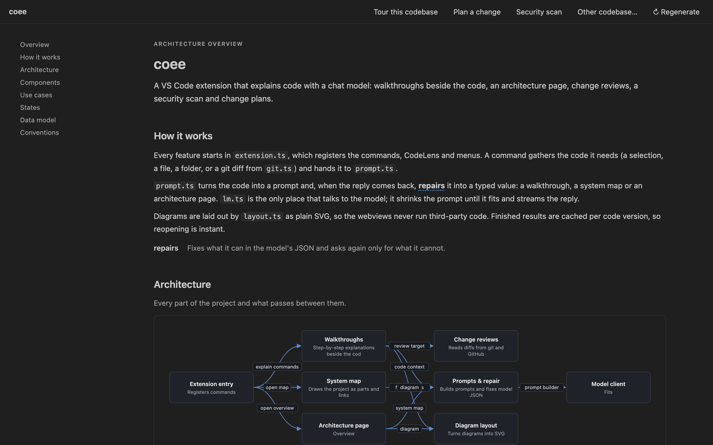

# coee

Understand any codebase without leaving VS Code. coee explains code step by step beside the source, describes how a project is put together, reviews your changes as you make them, scans for security gaps and plans new work. It only edits your files when you click **Insert** on code it proposes, and asks first.



## Features

**Walkthroughs.** Click **Explain** above any function or class, or use the book icon to explain a whole file. coee plans the steps from the code itself: where to start, then every function, class and method in the order they run, so nothing is skipped. Each step highlights its exact lines, explains them in plain language, and lists what it takes and gives, the rules inside it, and links to what it calls and what calls it, with a flow, sequence or state diagram where a picture helps. On any step you can ask for a **Simpler** or **Deeper** explanation, go **Line by line**, or ask your own question.

**Architecture overview.** coee's home page, describing the project: how it works, where execution starts, every component and how they connect, the API (each route with its handler, the data it takes and its guards), the business rules in plain words grouped by part, every data shape (DTO) with its fields and where it's used, the main use cases with sequence diagrams and the rules each one applies, lifecycles as state diagrams, and the data model as an ER diagram. The facts come from the code itself, so nothing is guessed; the model adds the explanations. It is the hub: **Walk me through** on any component or use case starts a step-by-step walkthrough in the editor, and as you move through the steps the page highlights the part you are reading. Clicking a file link opens exactly those lines. **Find** answers "where is X handled?" with links into the code. Big repositories (over 400 source files, or with workspace packages) start at the package level: each package, what it does and which packages it uses. Open one to see its own components, use cases, states and data.

**Changes.** coee watches your git repository and reviews what you change, without being asked. Fast checks run on every save; the model reviews each changed file when you stage it (or on save, or only on request: `coee.changes.autoReview`). Each file is reviewed together with the code that calls the functions it changed, so the review sees what the change can break; once every file is reviewed, one more pass reads the change as a whole (callers not updated, contracts changed on one side, missing tests, whether it does what its branch says). The model rates its own confidence and doubtful findings are left out. Findings appear as comments on the changed lines, in the Problems panel and in the status bar, each with **Apply suggestion** (previewed first), **Dismiss**, and a reply box to ask about it. The Changes page shows a verdict ("2 things to fix before you commit"), every changed file and its review, a suggested commit message, and **Walk me through it** for a step-by-step explanation. You can also compare your branch with main or look at any commit.

**Plan a change.** Describe a feature or technology you want to introduce. coee identifies the integration points, the affected components, the risks and a sensible order of work, against your real code. It includes the code to add, and always the tests. Each snippet is placed by the code around it, not by line numbers: **Add…** shows the file before and after, adds it when you agree, then checks that it landed in the right place and whether the file got new errors. Code that's already there shows as **Added ✓**, so nothing is added twice.

**Security scan.** Scan a file, a folder or the whole project in three passes:
- **Fast rules, no model:** 39 checks for hardcoded secrets (AWS, GitHub, Stripe and other key formats, passwords, connection strings), injection (SQL, shell, `eval`), XSS, path traversal, SSRF, open redirects, unsafe deserialization, buffer overflows in C/C++, weak crypto and randomness, disabled TLS checks and insecure configuration.
- **Dependency advisories:** from `npm audit` or `pip-audit` when installed, otherwise from OSV.dev.
- **The model:** confirms or rejects each rule hit in context, and finds what patterns can't see, such as missing authorization, IDOR and logic flaws.

Findings are grouped by OWASP Top 10 category, with a short explanation of each. Each finding shows what's wrong, why it has that severity, how it could be abused, the path the input takes through your code (from the route where it enters to the dangerous line, with where to validate it), the attack as a sequence diagram, how to check it yourself, and a fix you can apply (previewed). **Step through the attack** walks that path in the editor like a walkthrough, with the fix on the step where it belongs. **Prove it** saves a proof test beside the code and, after you confirm, runs it with your own test runner (node:test, jest, vitest, mocha, pytest or go test): it fails while the attack works and passes once the fix is in. It runs locally, never against a server, and only in a trusted workspace. Findings also appear in the Problems panel with a quick fix. **Not a problem** remembers false positives, and **Export SARIF** saves the results for GitHub code scanning. It is a review aid, not a guarantee.

## Getting started

1. Make sure a chat model is available in VS Code, for example GitHub Copilot.
2. Right-click your project folder and choose **coee review: project**. Everything else starts from there: walkthroughs, Changes, the security scan and planning.
3. In code, click **Explain** above a function for a step-by-step walkthrough.

| Where | What you can do |
|---|---|
| Right-click, in the Explorer or the editor | **coee review: project** opens the architecture hub; **coee review: file** walks you through the file |
| Any coee page | Switch between Architecture, Walkthrough, Plan, Changes and Security |
| Source Control title bar | Open Changes, explain a commit |
| Source Control Graph, right-click a commit | Explain a commit |

## Settings

| Setting | Default | Description |
|---|---|---|
| `coee.codeLens` | `true` | Show **Explain** above functions, methods and classes |
| `coee.changes.autoReview` | `onStage` | When Changes asks the model to review a changed file: `onStage`, `onSave` or `off`. Fast checks always run |
| `coee.cache` | `true` | Keep finished explanations so reopening is instant. The setting includes a **Clear cache** link |
| `coee.modelFamily` | | Preferred chat model, for example `gpt-4o`. Empty uses the first available model |

## Privacy

coee sends code to the chat model selected in VS Code, through the VS Code Language Model API. It needs no API key of its own:
- **Explanations, plans and the architecture page** send the code they explain.
- **Changes** sends each changed file and its diff.
- **The security scan** sends the files it scans, configuration files included. Don't scan folders that hold secrets you wouldn't share with the model.

The dependency check sends only package names and versions to OSV.dev, and only when `npm audit` or `pip-audit` isn't available.

coee changes your files only when you click **Add** or **Apply** and confirm. In a folder you haven't trusted, it doesn't run git or audit tools, because a repository's own configuration can make them run programs.

## Development

```sh
npm install && npm test   # build and run the unit tests
npm run test:integration  # run the extension in a real VS Code (uses your installed VS Code)
npm run harness           # what coee finds in the sample projects in test/fixtures, and what reaches the model
npm run package           # create coee-x.y.z.vsix
```
